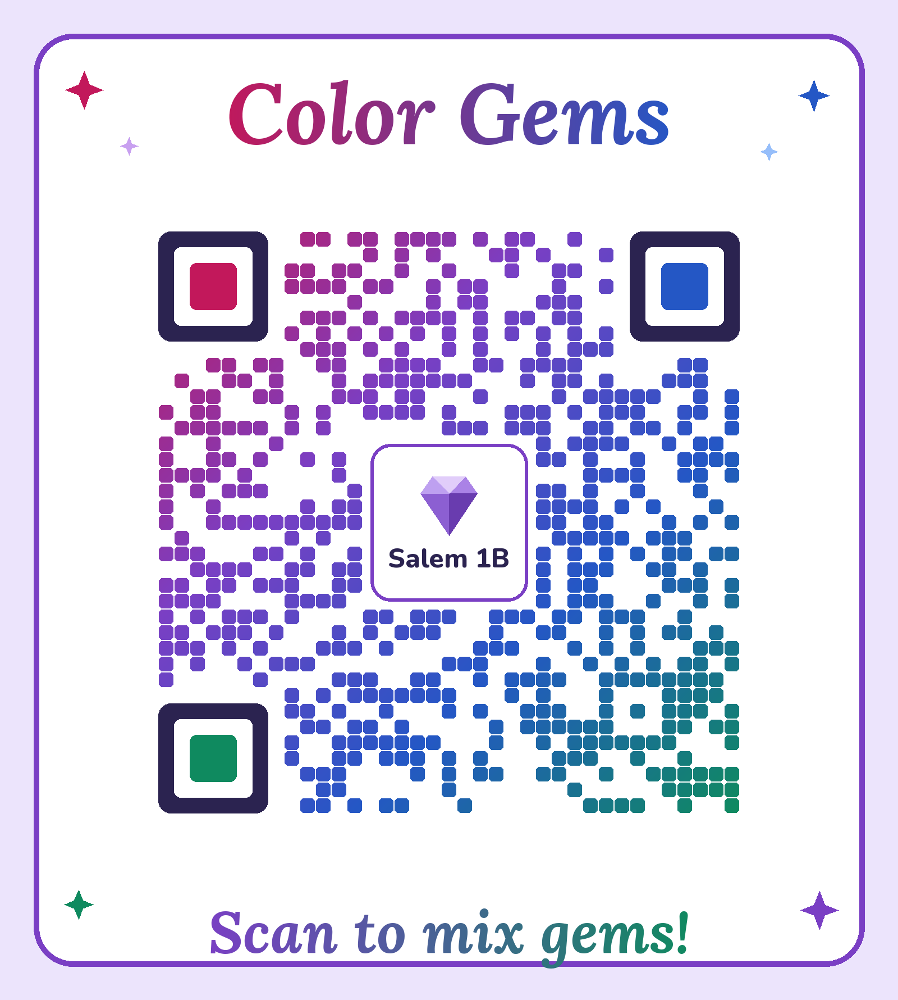

# Color Gems: Mix gems, not water!

Painting with paints uses a lot of water to wash brushes, and it makes waste: old tubes, jars and dirty palettes. **Color Gems** mixes colors with light instead. You stack layers of see-through colored cellophane and look at them against a white board, so there is no paint and no water. The model is made from recycled cardboard and cellophane. In Color Gems every color is a gem, and new colors are new gems to discover. **Mix gems, not water!**

**Play the game:** https://galynaal.github.io/color-gems/

## How the model works
- **Parts:** five cardboard circles (40 cm): one front panel and four discs that turn. The discs are **Ruby** (red), **Citrine** (yellow), **Sapphire** (blue) and **Emerald** (green).
- **Windows:** the front panel has one window at the top. Each disc has two windows opposite each other: one covered with cellophane, one left open. The cellophane sits between two thin card rings, like a sandwich.
- **Mixing:** all circles turn on one bolt. Turn a disc so its colored window is at the top and that gem is in the mix. Turn it half a turn and the open window is at the top, so that gem is out. Any 2, 3 or 4 gems can be mixed (15 combinations).
- **Tabs and marks:** each disc has a gem-shaped tab on its rim. Marks on the front panel show "in the mix" (top) and "out" (bottom).
- **Color wheel:** a paper wheel in the middle shows Ruby, Amber, Citrine, Jade, Sapphire and Amethyst.
- **Stand:** a white backboard on a base with two braces. The circles turn in front of it. A pocket on the base holds the cards.
- **Diamond:** a clear, milky layer that makes colors lighter. It exists only in the web game.

## Gems and mixes
| Gem | Recipe |
|---|---|
| Ruby, Citrine, Sapphire, Emerald | single gems |
| Amber | Ruby + Citrine |
| Amethyst | Ruby + Sapphire |
| Jade | Citrine + Sapphire |
| Smoky quartz | Ruby + Emerald (also Ruby + Citrine + Sapphire) |
| Peridot | Citrine + Emerald |
| Aquamarine | Sapphire + Emerald |
| Tiger's eye | Ruby + Citrine + Emerald |
| Hematite | Ruby + Sapphire + Emerald |
| Dark emerald | Citrine + Sapphire + Emerald |
| Onyx | all four |

The game's names are predictions. Real cellophane may give other shades, so checking them with the model is part of the experiment.

## The game
One HTML file, with no build step and no frameworks. The games are Free mixing, Challenge, Mystery and Two players, plus a collection of 15 gems with awards (Gem Finder, Gem Explorer, Master Jeweler).

## Files
- `index.html`: the game (published with GitHub Pages from `main`, `/ (root)`)
- `qr/`: QR codes (color and black-and-white) and `make_qr.py`, which makes them and checks that they decode
- `tests/`: Playwright tests (`node tests/test_game.mjs`), results and screenshots

## Privacy
No personal data is collected. There are no trackers, analytics, cookies or ads. The game saves found gems only in your own browser (`localStorage`). The only outside resource is Google Fonts.

---
A Young Entrepreneurs project by Salem, 1B
